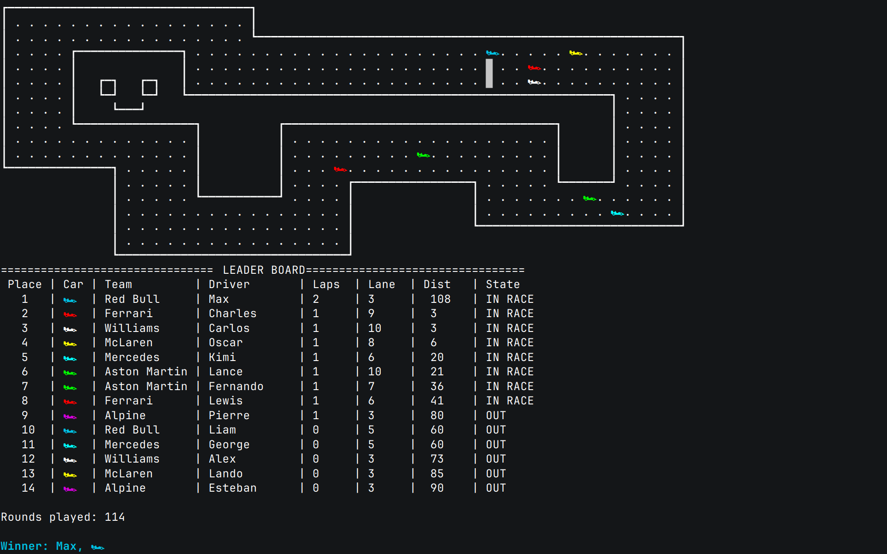

# Автогонки



## Сборка

```sh
cmake -S . -B build -DCMAKE_BUILD_TYPE=Release
cmake --build build
```

## Запуск

Демо на карте `twisty` с 14 машинами (сервер и машины запускаются в фоне):

```sh
./demo.sh
```

Из корня проекта, каждую команду — в отдельном терминале:

```sh
./bin/race --cars 2 --laps 3 --port 8080 --map data/circle --output /tmp/race.log
./bin/viewer --ip 127.0.0.1 --port 8080
./bin/car --driver Ullubiy --team Ferrari --color 31 --ip 127.0.0.1 --port 8080
./bin/car --driver Gosha --team "Red Bull" --color 36 --ip 127.0.0.1 --port 8080
```

Для запуска по сети замените `127.0.0.1` на IP сервера.
Можно запустить несколько viewer. `Ctrl+C` на сервере завершает клиентов.

## Управление машиной

ID машины указан в выводе сервера. Команды выполняются во время гонки:

```sh
./bin/control --port 8080 --disconnect 0
./bin/control --port 8080 --restore 0
```

## Тесты

```sh
./tests/run_all.sh
```

## Справка

```sh
./bin/race --help
./bin/car --help
./bin/viewer --help
./bin/control --help
```
